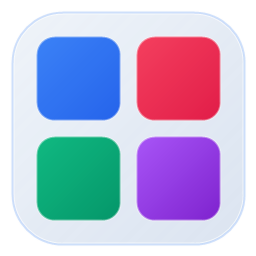
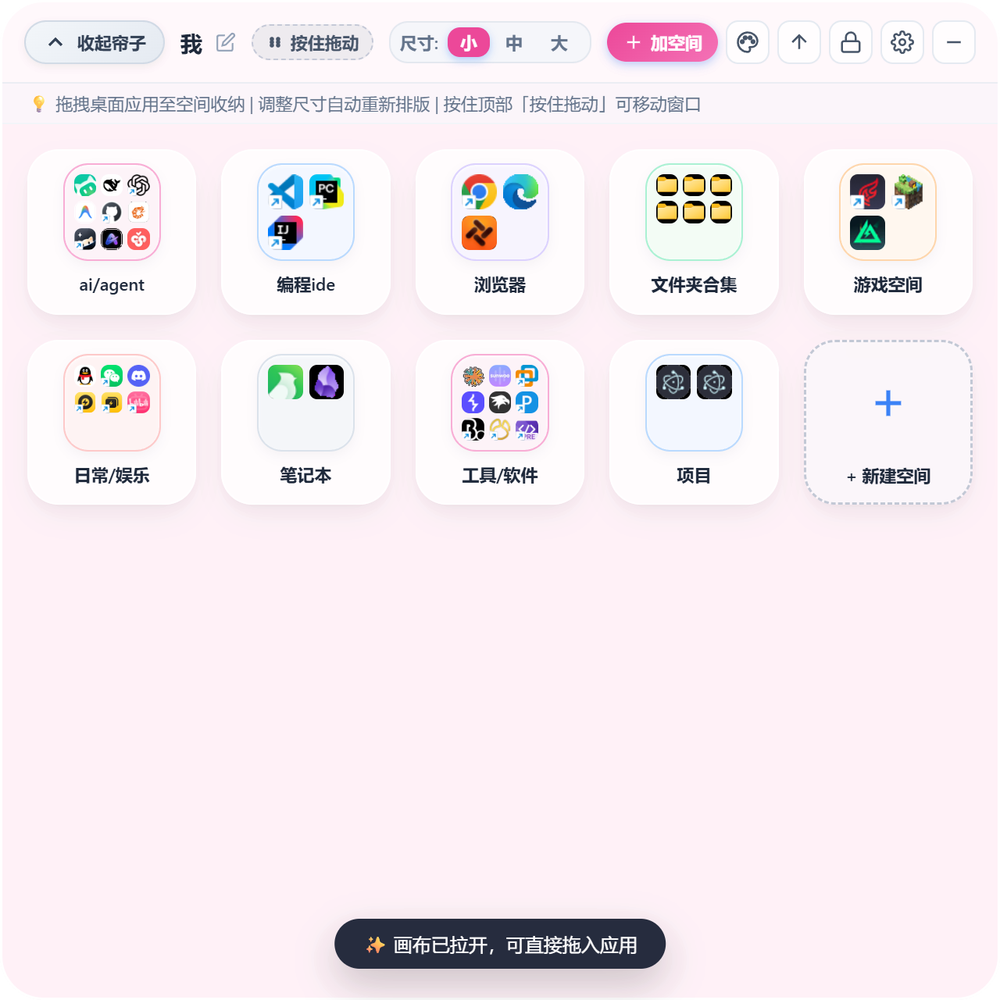
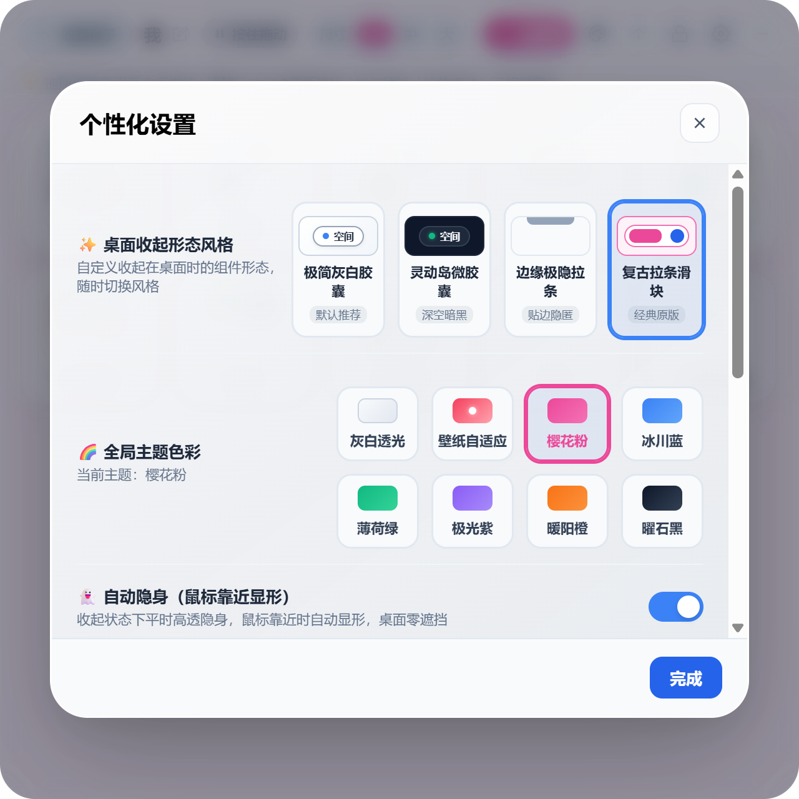

<div align="center">



# 桌面文件夹格子 (Desktop Folder Grid)

### 专为 Windows 打造的高颜值仿手机/平板桌面文件夹空间小组件

[](LICENSE)
[](https://microsoft.com/windows)
[](https://www.electronjs.org/)
[](https://nodejs.org/)
[](#-下载体验)

[中文文档](README.md) | [English Documentation](README_EN.md)

</div>

---

## 📖 项目简介

**桌面文件夹格子** 是一款面向 Windows 桌面用户的轻量高颜值桌面整理小组件。借鉴了 iOS 与 HarmonyOS 的大文件夹交互体验，将传统杂乱的电脑桌面快捷方式整合成手机端般优雅的「聚合空间」。

支持**折叠为极简桌面拉帘/灵动胶囊**、**一键拉开全屏画布**、**鼠标靠近智能显形**、**开机自启动**以及**桌面壁纸色彩自适应磨砂质感**，让电脑桌面既干净整洁又保持极速启动。

---

## 🖼️ 界面预览

<div align="center">
  
  <p><em>▲ 展开状态：自适应排版、智能对称居中、卡片大小无级重排</em></p>
</div>

<div align="center">
  
  <p><em>▲ 空间内部：支持自定义专属空间色彩、原地双击命名与一键解散</em></p>
</div>

<div align="center">
  
  <p><em>▲ 个性化设置：形态切换、全局壁纸色识别、开机自启动一键开关</em></p>
</div>

---

## ✨ 核心特性

- 📱 **仿手机端文件夹聚合交互**：
  - 任意应用拖拽覆盖到另一个应用上，即刻触发呼吸光环，松开自动聚合成「文件夹空间」；
  - 文件夹空间支持一键解散为独立应用，或从空间中随时移回画布根目录。
- 🎯 **对称居中拉帘动效**：
  - 无论是吸顶居中放置还是靠边停靠，拉下帘子时严格以当前拉链为几何中心展开画布，收起时精准回弹归位，无偏移不对称问题。
- 🚀 **开机自启动（双保险机制）**：
  - 支持 Windows 系统开机自启（结合注册表 Run 项与启动目录双通道保障）；
  - 提供设置面板开关与系统托盘右键菜单随时勾选。
- 👻 **智能隐身（鼠标靠近自动显形）**：
  - 收起为小挂件时，平时保持高透轻盈隐身状态，完全不遮挡壁纸与工作视线；
  - 鼠标光标靠近 55px 范围内，0.15 秒内平滑现形。
- 🎨 **桌面壁纸色彩智能识别**：
  - 原生 C# 高速调取 Windows Shell API 提取当前壁纸主色调；
  - 自动渲染温润灰白透光或同色系细腻毛玻璃材质（支持 8 种精选调色板）。
- 🖼️ **原生超清快捷方式图标提取**：
  - 拖入桌面任意 `.exe`、`.lnk` 快捷方式或应用文档，内置原生提取器自动生成高清无损透明图标。
- 📐 **动态网格重排与尺寸调节**：
  - 支持 `小`、`中`、`大` 三种格子尺寸，根据当前空间数量自动重排，空间利用率极大提升。
- 🏷️ **全场景快速重命名**：
  - 网格卡片标题**直接双击**即刻进入行内编辑，回车保存；
  - 空间内部、新建空间与画布标题均配有专属重命名窗口。
- 🖐️ **直观的窗口按住拖动引导**：
  - 顶部配有醒目的「⋮⋮ 按住拖动」徽章与全局拖动热区，移动窗口位置清晰直观。

---

## 🕹️ 交互指南

| 目标操作 | 快捷交互方式 |
| :--- | :--- |
| **展开/收起画布** | 单击顶部拉帘/胶囊展开；点击画布顶部「收起帘子」或按 `Esc` 收起 |
| **移动窗口位置** | 按住顶部「⋮⋮ 按住拖动」区域或顶部空白处拖拽 |
| **合并新建空间** | 按住卡片拖拽重叠覆盖到另一张卡片上松开 |
| **原地重命名** | 直接**双击**卡片下方的文字标签即可原地输入，按回车保存 |
| **打开空间详情** | 单击文件夹卡片缩略图展开空间大弹窗 |
| **拖入桌面应用** | 从电脑桌面或文件夹直接将快捷方式拖拽进画布即可自动收纳 |
| **个性化设置** | 点击右上角 ⚙️ 图标唤起设置中心，调节透明度、形态与开机自启动 |
| **托盘快捷菜单** | 右键任务栏右下角小图标，随时切换置顶、开机自启或重置数据 |

---

## 📦 下载与安装

### 方式一：下载绿色免安装版（推荐）
1. 在项目发布页 [Releases](../../releases) 下载最新发布的压缩包；
2. 解压后直接进入 `打包输出/桌面文件夹格子_绿色免安装版`；
3. 双击 `桌面文件夹格子.exe` 或运行 `双击启动_桌面文件夹格子.bat` 即可开箱即用！

---

## 🛠️ 源码开发与构建

### 1. 环境准备
- [Node.js](https://nodejs.org/) (推荐 v18.0 或更高版本)
- [Git](https://git-scm.com/)

### 2. 克隆项目
```bash
# GitHub
git clone https://github.com/your-username/desktop-folder-grid.git

# 或 Gitee
git clone https://gitee.com/your-username/desktop-folder-grid.git

cd desktop-folder-grid
```

### 3. 安装依赖
```bash
npm install
```

### 4. 本地开发调试
```bash
npm start
```

### 5. 一键打包编译
运行打包命令生成 Windows 免安装绿色发行版：
```bash
npm run pack
```
打包输出目录位于项目根目录下的 `release/win-unpacked` 或 `打包输出/桌面文件夹格子_绿色免安装版`。

---

## 📂 项目架构

```plaintext
desktop-folder-grid/
├── assets/                    # 图标与静态视觉资产
│   ├── icon.ico               # Windows 多分辨率应用图标 (256x256 ~ 16x16)
│   ├── icon.png               # 高清 PNG 图标
│   └── icon-32.png            # 任务栏与系统托盘小图标
├── docs/                      # 文档与演示插图
│   └── images/                # README 演示截图
├── renderer/                  # 前端交互与界面渲染层
│   ├── index.html             # 主窗口与弹窗结构 (Canvas, Modals, Forms)
│   ├── styles.css             # 毛玻璃拟态、动效及各形态主题样式
│   └── app.js                 # 核心事件逻辑 (网格自排版, 拖拽合并, 行内编辑)
├── main.js                    # Electron 主进程 (窗口生命周期, 几何居中计算, 开机自启)
├── preload.js                 # 安全上下文桥接 (IPC 通信隔离)
├── ExtractIcon.cs             # 原生 C# Windows Shell 提取器源码
├── ExtractIcon.exe            # 原生超清图标与壁纸色彩分析器
├── package.json               # 项目配置与打包编译规范
├── LICENSE                    # MIT 开源授权协议
└── README.md                  # 中文使用说明
```

---

## 🤝 参与贡献

欢迎提交 Issue 与 Pull Request！
1. Fork 本仓库；
2. 创建您的特性分支 (`git checkout -b feature/AmazingFeature`)；
3. 提交您的修改 (`git commit -m 'feat: Add some AmazingFeature'`)；
4. 推送至分支 (`git push origin feature/AmazingFeature`)；
5. 新建 Pull Request。

---

## 📄 开源许可证

本项目采用 [MIT License](LICENSE) 许可证，免费供个人与商业使用，请保留版权声明与授权许可。
