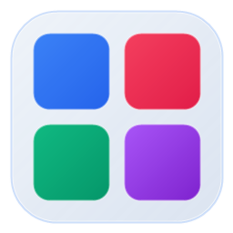
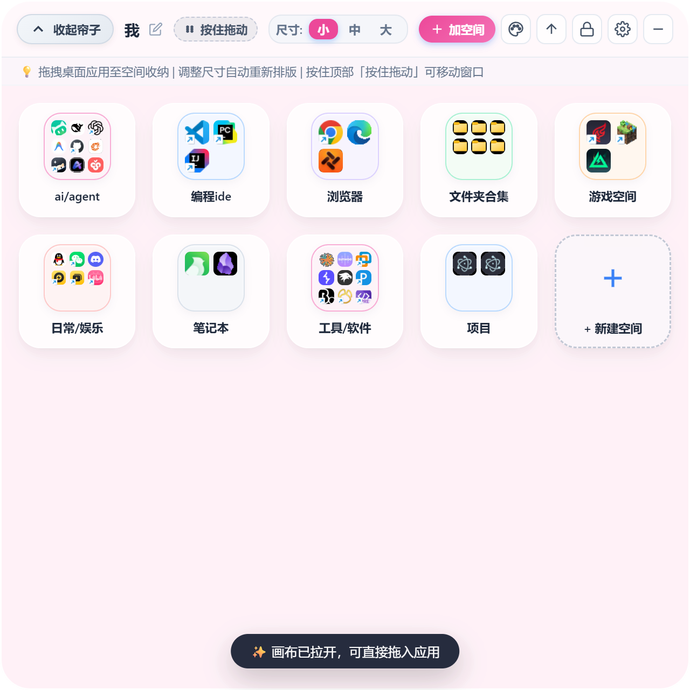

<div align="center">



# Desktop Folder Grid

### Elegant Mobile & Tablet-Style Desktop Folder Space Widget for Windows

[](LICENSE)
[](https://microsoft.com/windows)
[](https://www.electronjs.org/)
[](https://nodejs.org/)
[](#-download--run)

[中文说明](README.md) | [English Documentation](README_EN.md)

</div>

---

## 📖 Overview

**Desktop Folder Grid** is a lightweight, aesthetically refined Windows desktop widget designed to organize your cluttered shortcuts into iOS / HarmonyOS-style expandable folder spaces.

It features **smooth curtain drop-down animation**, **intelligent horizontal symmetry centering**, **stealth mode with hover reveal**, **auto-launch on startup**, and **real-time wallpaper color extraction** with frosted glassmorphism visuals.

---

## 🖼️ Screenshots

<div align="center">
  
  <p><em>▲ Expanded Canvas: Symmetrical centering, adaptive reflow, dynamic card resizing</em></p>
</div>

<div align="center">
  
  <p><em>▲ Folder Space Modal: Custom folder theme palette, inline double-click rename & disband</em></p>
</div>

<div align="center">
  
  <p><em>▲ Personalization Settings: Widget styles, auto wallpaper detection, auto-launch toggle</em></p>
</div>

---

## ✨ Features

- 📱 **Mobile-Style Folder Aggregation**:
  - Drag one shortcut over another to trigger a glowing aura and merge into an interactive folder space.
  - Disband any folder back into independent apps with a single click.
- 🎯 **Symmetrical Curtain Animation**:
  - Drops down smoothly around the exact center of your zipper pull, ensuring perfect left/right symmetry on any monitor.
- 🚀 **Auto-Start on Boot (Dual-Guarantee)**:
  - Supports Windows startup through both Registry Run keys and Startup shortcuts.
  - Toggable directly from the Settings modal and System Tray context menu.
- 👻 **Proximity Stealth Mode**:
  - Transparent and unobtrusive on your wallpaper when collapsed.
  - Automatically reveals itself within 0.15s when your cursor hovers nearby.
- 🎨 **Adaptive Wallpaper Color Detection**:
  - Extracts the dominant tone of your current Windows wallpaper via native Shell APIs.
  - Seamlessly blends into frosted glass with matching hues.
- 🖼️ **Native High-Definition Icon Extraction**:
  - Drag any `.exe`, `.lnk`, or document to extract crisp 32-bit transparent icons.
- 📐 **Dynamic Grid Reflow**:
  - Choose between Small, Medium, and Large grid cards with instant layout recalculation.
- 🏷️ **Instant Inline Renaming**:
  - Double-click any folder or app title on the canvas to rename directly with Enter/Esc shortcuts.

---

## 📦 Download & Run

1. Grab the latest portable release from [Releases](../../releases);
2. Unzip and open `release/win-unpacked` (or `打包输出/桌面文件夹格子_绿色免安装版`);
3. Double-click `桌面文件夹格子.exe` to run immediately without installation!

---

## 🛠️ Build from Source

```bash
# Clone repository
git clone https://github.com/your-username/desktop-folder-grid.git
cd desktop-folder-grid

# Install dependencies
npm install

# Run in development mode
npm start

# Build portable Windows release
npm run pack
```

---

## 📄 License

This project is licensed under the [MIT License](LICENSE).
